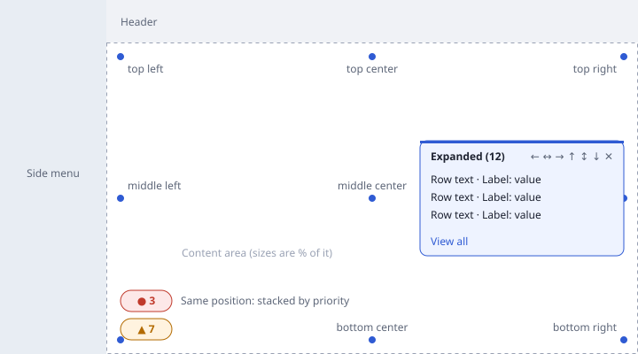

# Collapsible Banners

A banner is a small badge drawn over the page content: an icon with a count,
a title or both. It expands into a panel listing rows when clicked. Each
banner is defined in a `banners.json` file and shows the rows of a **model**,
a **named query** or an **ORM query**, narrowed by the same filter rules as the
List page's **Advanced filters** panel. Banners need no Python or React code.

IQVigilant's Exception Alerts badge is one of them. A host app, an extension
package or an external website of a host app can show its own banners the
same way.



## Where banners are defined

| File | Who owns it | Priority |
|---|---|---|
| `<package>/<banners_file>` (e.g. `iqvigilant/modules/exception_alert/banners.json`) | An extension package, declared by its manifest's `banners_file` | Lowest; extensions in the order the app enables them |
| `backend/config/banners.json` (next to `jm_config.ini`) | The host app | Highest |

The files are merged **by banner key**. A host app can therefore change one
setting of an extension's banner without copying it:

```json
{
  "exception_alerts": {
    "position": {"horizontal": "right"},
    "show_on": {"all": true, "sites": ["employer-portal"]}
  }
}
```

It can also turn an extension's banner off with `{"exception_alerts": {"enabled": false}}`.

`position`, `collapsed` and `expanded` merge key by key: the override above
keeps the extension's `vertical` position. Every other key, such as
`source`, `filters` and `show_on`, is replaced whole.

The files are read again whenever one of them changes, so editing
`banners.json` needs no restart. An invalid banner is left out and logged with
`jm_log`; the other banners still show.

## A banner definition

A file is a JSON object keyed by banner key. Only `source` is required.

```json
{
  "open_critical_tasks": {
    "title": "Critical tasks",
    "icon": "FireOutlined",
    "tone": "error",
    "source": {"model": "Task"},
    "filters": [
      {"fieldKey": "priority", "operator": "equals", "value": ["critical", "high"]},
      {"fieldKey": "status", "operator": "equals", "value": "todo"}
    ],
    "sort": {"field": "due_date", "order": "asc"},
    "display_fields": ["title", {"key": "due_date", "label": "Due"}],
    "max_rows": 20,
    "show_on": {"modules": ["tasks", "projects"]},
    "position": {"horizontal": "right", "vertical": "bottom"},
    "collapsed": {"max_width": 20, "max_height": 6},
    "expanded": {"max_width": 40, "max_height": 60},
    "collapsed_content": "title_and_count",
    "movable": true,
    "priority": 5
  }
}
```

| Key | Default | Meaning |
|---|---|---|
| `source` | — | What the banner lists; see [Sources](#sources) |
| `filters` | `[]` | [Advanced-filter rules](#filters) selecting the rows |
| `sort` | none | `{"field": "<key>", "order": "asc" \| "desc"}` (model and named query sources; an ORM spec has its own `order_by`) |
| `display_fields` | first three columns other than `id`/`eid` | Columns shown for each row, as field keys or `{"key", "label"}` objects. The first column is the row's text; the others follow it as `Label: value` |
| `max_rows` | `50` | Rows listed when expanded. The count always covers every row |
| `title` | `""` | Expanded header and accessible name; translated with `_()` |
| `icon` | `NotificationOutlined` | Name of an [Ant Design icon](https://ant.design/components/icon) |
| `tone` | `neutral` | `neutral`, `info`, `success`, `warning` or `error`; colours come from the active Ant Design theme, in light and dark mode |
| `show_on` | `{"all": true}` | [Which pages](#which-pages-show-a-banner) show the banner |
| `position` | `{"horizontal": "left", "vertical": "bottom"}` | `horizontal`: `left`, `center`, `right`. `vertical`: `top`, `middle`, `bottom` |
| `collapsed` | `{"max_width": 25, "max_height": 10}` | Maximum size of the collapsed badge, in **percent** of the content area's width and height |
| `expanded` | `{"max_width": 50, "max_height": 50}` | Maximum size of the expanded panel, in percent of the content area |
| `collapsed_content` | `count` | What the badge shows next to its icon: `count`, `title`, `title_and_count` or `icon` (icon only) |
| `row_resource` | the model's table name, or the named query's name | Resource whose Show page a row opens (`/<resource>/show/<eid>`). `null` for an ORM source unless set |
| `view_all_resource` | `row_resource` | Resource whose List page the **View all** link opens; `null` hides the link |
| `movable` | `true` | Show the [position arrows](#moving-a-banner) |
| `priority` | `0` | Higher first: nearer the edge when banners share a position |
| `hide_when_empty` | `true` | Leave the banner out while its query has no rows |
| `enabled` | `true` | `false` removes the banner (typically a host app turning off an extension's banner) |

The banner's **count is the number of rows its query selects**. With a grouped
ORM query, that is the number of groups.

## Sources

Every source is an ORM statement executed with `jm_execute_orm`. A banner is
left out for a user who may not read the models it queries. That check runs
the same access decision as the CRUD endpoints (licensing, role methods, role
access policy, `@model_access`). A model source also applies the model's
row-level `@rebac` filter.

### Model

```json
"source": {"model": "Task"}
```

The class name or the table name (`"task"`, `"jm_exceptionalert"`). Rule
`fieldKey`s are the model's attributes.

### Named query

```json
"source": {"named_query": "projects_with_tasks_and_members"}
```

Any loaded named query (from a module's `queries.py` or `named_queries.json`,
in the host app or an extension). Rule `fieldKey`s are the named query's field
keys, and its field labels are the default column labels.

### ORM query

```json
"source": {"orm": {
  "from": "Exceptionalert",
  "select": [
    ["col", "Exceptionalert", "description"],
    ["agg", "count", "Exceptionalert", "eid", "alert_count"],
    ["agg", "min", "Exceptionalert", "eid", "eid"]
  ],
  "where": [["Exceptionalert", "status", "!=", "Solved"]],
  "group_by": [["Exceptionalert", "description"]],
  "order_by": [["agg", "count", "Exceptionalert", "eid", "desc"]]
}}
```

The same dict spec `jm_build_orm_query_from_spec` accepts: `from`, `select`,
`joins` (by relationship name, never by foreign-key columns), `where`,
`group_by`, `having`, `order_by`, `distinct`, `limit`. Raw SQL fragments
(`["raw", ...]` or `{"raw": ...}`) are rejected. The rows are the
`select` columns, by their aliases. Select an `eid` column if rows should open
a record, and set `row_resource`.

`filters` apply to ORM sources too. A rule's `fieldKey` is a column of the
`from` model, or `"Model.column"` for a joined model. The rules filter the
rows **before** `group_by`, so they can select on columns the grouped result
doesn't include, such as `urgency_level` above.

## Filters

`filters` takes the rules the List page's **Advanced filters** panel builds,
with the same keys, so a rule can be copied from a saved list view:

| Operator | Field type | Rule |
|---|---|---|
| `contains` | text | `{"fieldKey": "title", "operator": "contains", "value": "invoice"}` (case-insensitive) |
| `equals` | text | `{"fieldKey": "status", "operator": "equals", "value": "Open"}` |
| `eq`, `gt`, `gte`, `lt`, `lte` | number | `{"fieldKey": "hours", "operator": "gt", "value": 8}` |
| `between` | number | `{"fieldKey": "hours", "operator": "between", "value": 2, "value2": 8}` |
| `on`, `after`, `before` | date | `{"fieldKey": "due_date", "operator": "before", "value": {"mode": "absolute", "date": "2026-12-31"}}` |
| `between` | date | `"value"` and `"value2"` dates |
| `is` | boolean | `{"fieldKey": "active", "operator": "is", "value": true}` |

Dates can also be relative, like the panel's **Previous / Current / Next**
options. Weeks start on Sunday, as on the List page:

```json
{"fieldKey": "due_date", "operator": "on",
 "value": {"mode": "relative", "direction": "next", "count": 1, "unit": "weeks"}}
```

`unit` is `days`, `weeks`, `months`, `quarters` or `years`; `direction` is
`previous`, `current` or `next`.

- **All rules must match (AND)**, as on the List page.
- **A list `value` matches any of its values (OR)**, so one rule selects
  several values of a field:
  `{"fieldKey": "urgency_level", "operator": "equals", "value": ["Critical", "Very critical"]}`.
- A rule naming an unknown field selects **no** rows (and is logged), so a
  typo never shows every row. Incomplete rules (no operator or value) are
  skipped, as on the List page.

## Which pages show a banner

| `show_on` | Shown on |
|---|---|
| `{"all": true}` | Every page of the host app |
| `{"models": ["Task", "projects_with_tasks_and_members"]}` | The List, Show, Edit and Create pages of those models or named queries (class name, table name or named query name) |
| `{"modules": ["tasks"]}` | The pages of every model and named query of those modules |
| `{"sites": ["employer-portal"]}` | Every page of those external websites; see [External websites](#external-websites) |

`models` and `modules` can be combined; a page matching either shows the
banner. `sites` targets external websites only, and a banner without `sites`
never shows on one. Combine `sites` with `all` (or `models`/`modules`) to show
a banner on both the host app and a website.

## Placement, sizes and overlap

A banner sits at one of nine positions of the **content area**: the page
content beside the side menu and below the sticky header, kept current as the
menu collapses, the window resizes and the page scrolls. Sizes are percentages
of that area, so they follow the window.

Banners never cover each other:

- **Same position:** banners that share a position are stacked in one column,
  `priority` first nearest the edge, 8 px apart. The column never outgrows the
  content area. An expanded panel shrinks and scrolls instead.
- **Expanded on top:** an expanded banner is drawn above banners at other
  positions.
- **One expanded at a time:** expanding a banner collapses the one that was
  open. An app that wants several open at once renders `BannerHost` with
  `singleExpanded={false}`.
- **Collapsing:** **Esc** or the panel's close button collapses it.

The expanded panel opens towards the inside of the page: above a bottom
banner, below a top or middle one.

### Moving a banner

When `movable` is true, hovering a banner, or expanding it, shows six arrows:
**move to the left edge, the center, the right edge, the top, the middle,
the bottom**. Each changes one axis and keeps the other; the current position's
arrows are disabled. A moved banner keeps its new position until the page is
reloaded. Positions are not saved.

## In the host app

Every host app shows its banners without code: the framework's `LayoutWrapper`
renders `AppBannerHost`, which reads the current route to find the page's
resource and fetches the banners again on each navigation. Rows open their Show
page and **View all** opens the List. To turn the banners off in a host app,
pass `showBanners={false}` to `LayoutWrapper`. To let banners target
modules on pages the backend can't place in a module, pass
`bannerModels={allSystemModels}`. New apps get both from `veloiq new`.

The data comes from one endpoint:

```
GET /api/veloiq/banners?resource=<resource>&module=<module>&site=<site>
```

It returns `{"banners": [...]}`, highest `priority` first. Each banner holds its
display settings, `count`, `columns` and its first `max_rows` `rows`. All
parameters are optional; with none, only `show_on.all` banners apply.

## External websites

An external website of a host app (a candidate portal, an employer portal, a
storefront) is a separate React app that doesn't use Refine or the rest of
`@juicemantics/veloiq-ui`. It imports the light entry point, which depends
only on React, Ant Design and its icons:

```tsx
import { BannerHost } from "@juicemantics/veloiq-ui/banner";
import { authFetch } from "./api";   // fetch() with the website's own Bearer token

<AntLayout>
  <AntLayout.Header>…</AntLayout.Header>
  <AntLayout.Content>{children}</AntLayout.Content>
  <BannerHost context={{ site: "employer-portal" }} fetcher={authFetch} />
</AntLayout>
```

- **`site`** is the key `show_on.sites` lists.
- **`fetcher`** carries the website's own authentication. A website whose
  proxy already adds the token (such as a storefront with a service account)
  leaves it out.
- **Rows:** without `onOpenRow` and `onViewAll`, rows open nothing and there
  is no **View all** link, which suits users who can't reach the host app's
  pages.
- **Access:** the website user's role needs read access to the banner's
  models. Banners it can't read are left out.
- **Duplicate copies:** when the package is `npm link`ed from a local
  checkout, add `resolve: { dedupe: ["react", "react-dom", "antd",
  "@ant-design/icons"] }` to the website's `vite.config.ts` so only one copy
  of React and Ant Design loads.

Example: VeilMatch shows IQVigilant's Exception Alerts banner on its employer
portal, and not on its candidate portal, with this `backend/config/banners.json`:

```json
{"exception_alerts": {"show_on": {"all": true, "sites": ["employer-portal"]}}}
```

## Shipping banners in an extension package

Put a `banners.json` in the package and name it in the manifest. Add it to the
package data so it's in the wheel:

```python
class ExtensionManifest(VeloIQExtension):
    name = "myext"
    modules_package = "myext.modules"
    banners_file = "modules/alerts/banners.json"   # relative to the installed package
```

```toml
[tool.setuptools.package-data]
myext = ["modules/alerts/banners.json"]
```

Host apps can then override or disable the extension's banners by key in their
own `config/banners.json`.

## Building your own collapsible banner

The components are exported for code that needs a collapsible banner with
content of its own. They are available from both `@juicemantics/veloiq-ui`
and `@juicemantics/veloiq-ui/banner`:

| Export | Use |
|---|---|
| `CollapsibleBanner` | The badge and its expanded panel, with any React content. Props: `title`, `icon`, `tone`, `collapsedContent`, `headerExtra`, `children`, `footer`, `position`, `contentRect`, `collapsedSize`, `expandedSize`, `movable`, `onMove`, `expanded`/`onExpandedChange` |
| `ModelBanner` | A `CollapsibleBanner` drawn from one banner payload of the endpoint |
| `BannerHost` | Fetches and places a page's banners. Props: `context`, `apiUrl`, `fetcher`, `onOpenRow`, `onViewAll`, `contentSelector`, `headerSelector`, `refreshKey`, `zIndex`, `singleExpanded` |
| `AppBannerHost` | The host app's `BannerHost`, reading the route (main entry point only) |
| `useContentRect` | The content area banners are placed in |
| `anchorGroupStyle`, `groupBannersByAnchor`, `percentSize`, `bannerMoves` | The layout rules, for custom placement |

`CollapsibleBanner` only draws the banner. Place it inside an element styled
with `anchorGroupStyle(position, contentRect)` (as `BannerHost` does) to put it
at its position of the content area.

## Translations

`title` and the `label`s of `display_fields` are catalog msgids, translated in
the browser with `_()`. Add them to the `messages.po` of the package that
defines the banner: the extension's catalog for an extension banner, the host
app's for its own. Row values are data and are shown as they are.
